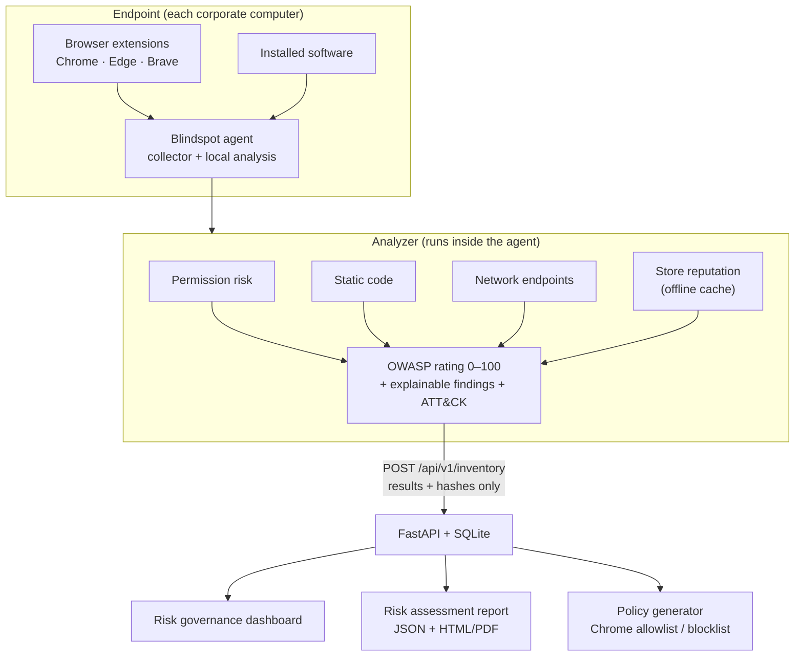

# Architecture

## Design decisions

| Decision | Why |
| --- | --- |
| Analysis runs on the endpoint | Extension source code and user data never leave the machine; the server receives results and hashes only. |
| Four independent signals | A single signal is easy to evade or misread; agreement between signals is stronger evidence. |
| OWASP Likelihood × Impact | A public, citable method ([METHODOLOGY.md](METHODOLOGY.md)). Each side is 0.6·strongest + 0.4·average, so one severe factor is never diluted. |
| Pin code, not IDs (Guard) | A hijacked update keeps the extension ID; a version + SHA-256 baseline catches it. |
| Unavailable signal ≠ safe | Missing store data is excluded from the score instead of counting as zero risk. |
| Every point has a finding | Analysts and auditors can see exactly why an extension scored what it did. |
| Each analyzer is isolated | A failing module marks its signal "n/a"; the pipeline keeps producing results. |
| Offline reputation cache | The Web Store has no official API; data is fetched ahead of time, so scans are fast and reproducible. |
| Output is a deployable policy | The tool ends with a fix (Chrome Enterprise policy), not only a finding. |
| Standard library core | The agent runs on any machine with Python and no installs. |
